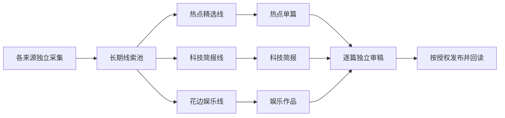

# 内容经营任务书

更新：2026-11-01。用户要求清空后重跑：已从零采集 15 源、479 条线索，完成两栏独立三筛、3 篇新作品和 6 份双平台草稿回读。工作台自动恢复原端口浏览器连接已实测；截图工具超时及纯空闲保活验证的未完成范围另列，不能称为全系统长期稳定。完整证据见 [全流程验收](全流程验收-20261101.md)。开发合同见 [开发实施说明](开发实施说明.md)，各栏目判断标准见 [三轮筛选约定](三轮筛选规则与实现约定.md)。

## 1. 最终目标

做一套能持续取得素材、按栏目选稿、制作内容、审稿、发布并核实结果的自动化系统。首批平台是微信公众号与今日头条，后续可供多个账号使用。人工参与逐步减少，不把当前一次采集接一次筛选的实现当成最终运行方式。

交付以可用内容、实际发布及反馈为准。采集量、模型返回通过、保存草稿分别记录，不能代替内容质量或发布成功。

## 2. 栏目线是基本生产单位

栏目线围绕一类读者需求，限定来源和选题范围，按自己的标准持续生产内容。它不等于来源网站、平台账号或“集合贴”这种形式。

**采集共用一个长期池；各栏目线先限定来源，再选内容，分别制作。**

| 栏目线 | 读者需要与选稿方式 | 内容形式与状态 |
| --- | --- | --- |
| 热点精选线 | 承接现有集中三筛，判断具体看点、参与空间和可写角度 | 单篇；已栏目化，沿用三筛 |
| 科技简报线 | 从 IT之家、极客公园、爱范儿、Solidot、少数派、36氪的已接入渠道取科技新增消息，保持整篇主题一致 | 集合稿；独立初筛、二筛与正文三筛 |
| 花边娱乐线 | 限定娱乐相关来源和事件，按这类读者的兴趣选稿 | 单篇或集合；用户提出的栏目示例，尚未配置 |

这些示例说明如何分线，不等于已经启用三个栏目。不能把商业新闻与无关网红婚礼混成同一篇集合贴；财联社、微博也都不能仅凭平台名称自动决定内容归属。

每条线只维护五项业务配置：

| 配置 | 要写清什么 |
| --- | --- |
| 来源名单 | 允许哪些媒体栏目、账号或榜单；粒度不能只到“整个微博” |
| 选题范围 | 面向谁、讲哪些事、不纳入哪些事、新闻有效时间范围 |
| 筛选要求 | 每栏独立填写初筛、二筛、正文三筛规则与单轮取材上限；按单篇或简报模式采用不同判断标准 |
| 内容形式 | 单篇或集合；同一材料可被不同作品引用 |
| 运行安排 | 何时筛选、何时出稿、发往哪个账号；与采集节奏分开 |

同一条线兼做两种形式时，选稿和使用记录按形式区分。栏目淘汰或某篇已用，均不能全局删除线索。

## 3. 最小流程

采集只保存来源、链接、标题、现成摘要、时间及来源提供的热度等基本信息，不在入池时研究全部正文。程序先按本线来源、时间与处理记录取候选，题材是否符合由本线选稿判断，不新增全池分类步骤。

所有栏目均有初筛、二筛和正文三筛，执行程序共用，渠道与三个阶段的规则分别保存。热点二筛比较单篇看点和写作角度；集合二筛比较新增信息、实际影响与整期搭配。只有二筛选中的少量事件才取正文，三筛按本栏标准核实；集合消息不要求具备单篇长文价值。新栏目选择适用模式并填写三个阶段的具体要求。

集合贴与单篇并行存在。“不足以单独写一篇”不等于“不能收入集合”；两者都需要实际事实依据。集合贴整篇还要检查主题一致、条目重复、排序和阅读价值。

## 4. 线索池只做必要的事

| 问题 | 最小规则 |
| --- | --- |
| 怎么入池 | 同来源稳定编号或链接复用记录；新增内容入池，已有内容更新；采集不等筛选 |
| 筛哪部分 | 按来源与时间取新增/变化/未完成项；已通过、目标账号尚未采用且仍有效的候选继续参与选稿，复用已有核实 |
| 怎么去重 | 同一条记录在入池时精确复用；不同报道是否同事件，在本线选稿时判断，保留全部可用来源 |
| 怎么退出 | 过本线有效期退出其候选；淘汰只对本线及该版本有效；材料不足等待补齐或到期；作品使用另记 |
| 怎么保留历史 | 退出某线不影响其他线；无活跃用途再归档，保留作品证据。新池从全新采集开始，不导入已要求清空的旧业务数据 |

初版采用线索表、栏目处理记录表，继续复用现有执行记录、材料快照与作品记录。不增加全局事件库、自动追踪服务或一套新的任务平台。新进展通过正常采集入池，在选稿时识别。

初版只承诺正常采集覆盖期间取得的内容。中断后能用公开列表补取就补；补不到的记录缺口，不声称完整覆盖，也不为每个来源先建复杂回补系统。

## 5. 当前范围与推进顺序

| 顺序 | 交付 | 完成依据 |
| --- | --- | --- |
| 1. 栏目与来源 | 选定要先启用的栏目，明确五项配置和可用来源 | 每个来源有适用理由与取得证据；不能只交网站名称 |
| 2. 采集入池 | 各来源的采集独立保存、重复更新、失败留记录 | 新采集不覆盖选择结果，筛选期间仍能入池 |
| 3. 栏目筛选 | 按本线范围取池中线索，执行三筛或集合选编 | 来源不串线、无固定晋级配额、未完成和未用候选不丢 |
| 4. 内容生产 | 单篇复用现有流程，集合增加条目编排和整篇审稿 | 每条有材料、整篇有统一主题，素材引用可追查 |
| 5. 运行与平台 | 采集与栏目按各自安排运行；本轮接入两平台草稿保存，正式发布留在最终目标 | 中断可续作且不重复；单篇和集合分别在两平台回读草稿成功，结果未知先核验 |

本轮按会话授权开发并验证全新内容，最终停在草稿；未授权公开发布，定时默认关闭。未扩大 12 条样本，不新增测试文件、框架或样本夹具。

## 6. 验证和效果

验证围绕已改动的行为，用全新内容及必要临时检查；业务采集、模型或平台运行先说明范围和实际消耗依据，按已有授权执行。保留首次失败、修正和重跑记录，缺少用量时标未知。

按栏目记录：来源是否补到有用选题、重复与缺口、选用情况、人工耗时、实际调用、发布结果及读者反馈。媒体自身流量不能代替本账号效果；先保证内容适合栏目，再优化成本。

技术细节见 [开发实施说明](开发实施说明.md)，来源证据见 [来源清单](../sources/来源清单.md)。日期交接和旧调查只作历史，不按其旧数量、账号状态或执行命令恢复任务。
