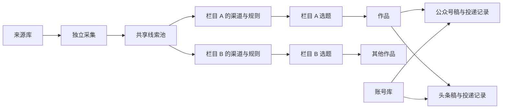

# 内容工作台架构与界面设计

2026-11-01。此文是设计和验收的固定依据；词义见 [CONTEXT.md](../CONTEXT.md)。末尾清单记录基础界面验收，后续各栏目三轮规则、扩源及实际四份新平台草稿的最终结果见 [全流程验收](全流程验收-20261101.md)。原有四份平台草稿及证据保留。

## 1. 产品与数据归属

| 对象 | 拥有的内容 | 边界 |
| --- | --- | --- |
| 来源 | 明确的采集入口、适配器、启用状态、采集间隔 | 共用来源只采集一次，不按栏目重复保存线索。新增网站结构需要对应适配器，不能把任意 URL 冒充已接入来源 |
| 线索池 | 来源身份、标题、摘要、时间、版本、采集证据 | 不持有全局“已经筛选/采用”标记；正文按选题需要读取 |
| 栏目 | 名称、渠道、定位、初筛/二筛/三筛规则、取材上限、筛选方式、成稿形式、创作要求、有效期、筛选安排、账号 | 创建/编辑在页面完成；渠道和各阶段规则按栏目隔离。停用不删除历史 |
| 选题 | 栏目内候选、关联材料、判断及证据、处理阶段 | 共享素材可得出不同栏目结论；不足材料不能自动算淘汰 |
| 作品 | 稳定身份、栏目、单篇/集合形式、所选内容、平台稿集合 | 列表每个作品一行；单篇/集合不是栏目类别 |
| 平台稿 | 对应账号的内容版本、排版、封面和审稿状态 | 编辑时明确当前平台；不暗中修改另一个账号稿件 |
| 投递 | 操作 ID、稿件版本、远端 ID、状态、实际回读 | 未知结果先核验；一个平台失败不重做另一个已成功平台 |
| 任务 | 采集、筛选、创作和同步的执行状态 | 用于进度、恢复和诊断，不取代栏目和作品的业务层级 |

当前兼容实现保留已验证的生产任务作为平台稿记录，服务端聚合为作品。新任务保存 `work_id`；旧稿通过独立 `work-links.json` 建立稳定关联，不改正文、版本、审稿或远端 ID。作品不是靠前端相同标题临时合并。作品各平台稿可有不同标题与排版，编辑页面明确所选平台；未实现的“统一主稿自动覆盖所有平台”不作承诺。

## 2. 配置与执行契约

栏目运行配置保存在数据目录 `column-config.json`。首次读取兼容源码中的现有 `columns.json`，第一次保存后以数据目录配置为准。配置有单调递增版本，所有修改带 `expected_revision`；旧版本返回冲突，不覆盖新配置。

栏目字段：

| 字段 | 约束/作用 |
| --- | --- |
| id | 服务端生成，稳定且不可编辑 |
| name | 1–40 字，去除首尾空格，同配置中不能同名 |
| sources | 非空、无重复、只能引用已接入来源 |
| rules | 栏目定位与范围，非空、最多 10000 字 |
| screening_rules | initial / selection / verification 三项必填，各最多 10000 字；分别用于初筛、二筛、正文三筛，按阶段计算缓存依据 |
| max_candidates | 页面“单轮最多取材”，整数 1–10；当前热点 2、科技 5，是上限而不是必须凑满的数量 |
| mode | 筛选方式：递进筛选、消息选编；内部兼容旧 `hotspot/digest` 编码，不作为栏目内容类型 |
| format | 单篇、集合；与筛选方式分别配置 |
| writing_rules | 可选创作要求，进入新稿创作输入；不使已核实的选题事实缓存失效 |
| valid_hours / edition_hours | 内容有效期、集合周期，合法有限正数；页面可编辑，不藏固定配额 |
| enabled | 启停本栏目；已有候选和作品保留 |
| interval_minutes | 筛选间隔；空表示手动，保存配置本身不执行筛选 |
| targets / auto_draft | 默认账号、自动制作并保存草稿；自动做稿必须有有效账号 |
| reference_domains | 现有补证范围兼容保留；仅沿已获准的实际入口取材 |

来源的启停与采集间隔在“渠道设置”页管理。栏目选渠道决定筛选范围；来源停用停止未来采集，已有有效线索仍可由引用它的栏目处理。

配置修改规则：

- 本栏目正在筛选时拒绝编辑，停止后再修改，避免修改运行中的输入。
- 规则、渠道或筛选方式改变后，本栏目旧候选需要按新依据筛选；仅改三筛规则时复用未变的归组、前两筛和正文。其他栏目不变，旧运行留存。
- 启停、运行间隔、目标账号和创作要求不充当事实核验依据；不因这些变化重做事实判断。
- 没有任何任务或采用记录的栏目可删除；有历史的栏目只可停用。
- 采集、栏目筛选和平台同步独立运行。固定平台操作不调用 AI 决定下一次点击。

## 3. API 与持久化

| 接口 | 行为 |
| --- | --- |
| GET /api/columns | 配置版本、栏目、来源，以及当前运行/历史状态 |
| POST /api/columns | 创建栏目；校验字段、渠道、账号、同名和版本 |
| PATCH /api/columns/:id | 修改栏目或启停；不自动触发制作 |
| DELETE /api/columns/:id | 仅删除未使用栏目 |
| PATCH /api/sources/:id | 修改已接入来源的采集设置 |
| GET /api/state?line_id=… | 当前栏目的候选、结果、进度及缺口 |
| POST /api/collect | 传 line_id 时仅采集该栏目已启用渠道；不传时沿用全局安排 |
| POST /api/screen | 栏目、选题范围和冻结输入；原任务恢复保留版本检查 |
| GET /api/production | 服务端作品聚合、平台稿和账号；状态保持各自归属 |
| 现有 production 写接口 | 继续使用版本检查、审稿失效和平台幂等约束 |

不引入新服务或另一个任务调度框架。现有 SQLite 的线索、栏目判断表继续复用；旧批次是运行证据。配置写入使用临时文件替换，服务内由工作台锁串行修改。

## 4. 页面与操作设计

全局导航为“栏目、线索池、选题、稿件、渠道设置、账号”。页面没有功能宣传、副标题说明、流程介绍或规则复述。字段标签、必要错误、运行状态和未保存保护保留，信息有具体作用才出现。

线索池 `/pool` 显示全部真实采集记录，提供标题/摘要搜索、来源分类、具体来源、所属栏目、处理状态、入池时间筛选和分页。来源分类表示采集渠道的类别，不伪称每篇文章已经做过语义分类。每条记录分别列出各栏目的处理结果；同一线索可在一个栏目入选、另一个栏目未采用，不能折叠成全局已处理标记。过期、未采用和待补证记录仍可查询，栏目规则或输入版本变化标记待复筛。详情显示摘要、真实入口及各栏目理由。渠道启停与采集间隔独立放在 `/sources`，名称为“渠道设置”。

`GET /api/pool` 接受 `q/category/source_id/line_id/status/hours/page/page_size`；时间按首次入池时间过滤，栏目过期状态按本栏目有效期计算；返回匹配总量、全池总量、当前页及筛选选项。读取不启动采集、筛选或改写业务记录。

| 页面 | 主体 | 主操作 | 次级操作/特殊状态 |
| --- | --- | --- | --- |
| 栏目 | 栏目卡片：名称、渠道、形式、运行状态 | 新建栏目、进入选题 | 编辑、启停；未使用时可删除。空状态直接提供创建入口 |
| 栏目编辑 | 内容设置/三轮规则/运行安排；三个独立规则框和单轮取材上限 | 保存栏目 | 取消；必填与版本冲突显示在当前表单；套用模板需确认，不能静默覆盖自定义规则 |
| 渠道设置 | 来源名、采集安排、状态 | 设置 | 启停、自动采集间隔；不在选题页复述来源配置 |
| 选题 | 栏目选择；可做稿/待处理；标题、来源、简短理由 | 勾选后做稿 | 当前栏目采集/筛选、继续失败任务；来源依据按需打开 |
| 制作 | 已选条目、顺序、目标账号 | 开始制作 | 改序、移出、返回选题；无条目或账号时不能开始 |
| 稿件 | 一作品一行；栏目、形式、各平台结果 | 打开作品 | 按状态、栏目查看；平台失败定位到对应平台稿 |
| 作品阅读 | 稿件正文；右侧各平台稿结果 | 编辑稿件 | 材料对照、条目调整、审稿；平台操作在所属平台旁 |
| 编辑稿件 | 标题、完整正文、统一格式工具栏 | 保存 | 取消；未保存离开保护；明确当前平台稿 |
| 账号 | 平台、身份、连接状态 | 添加账号、连接/核验 | 实际错误紧邻账号；未接入能力不显示为已支持 |

稿件封面支持更换和移除，使用同一版本冲突检查；移除封面不自动删除正文配图。正文编辑采用完整页面区域。工具栏分组、字号一致、当前格式有选中态、不可用动作有禁用态；上传控件使用中文按钮，隐藏浏览器默认英文文件框。正文区域有明确宽度、内边距、段间距和图片边界，工具栏与保存操作在长文滚动时可到达。材料对照和编辑区适配窄屏；弹窗有最大高度及固定操作区。

作品内容、审稿、草稿保存、公开发表分别显示。头条草稿未保留发布声明时，问题属于该平台的发布条件，不作为整篇文章的常驻红色错误。只有当前操作失败或实际需要处理的异常使用错误提示。

## 5. 原型交付

`frontend/prototype.html` 使用同一套页面组件和样式，通过独立的内存数据层演示栏目创建/编辑、渠道选择、选题、作品阅读、材料对照与编辑。顶层标明“交互原型”；不连接生产 API、不调用业务 AI、不上传或公开发表。原型内容来自本轮既有文章，属于设计演示，不增加真实采集样本。

构建后访问 [交互原型](http://127.0.0.1:18765/prototype.html#/columns)。另有 [空状态](http://127.0.0.1:18765/prototype.html?scene=empty#/columns) 与 [加载失败](http://127.0.0.1:18765/prototype.html?scene=error#/columns) 场景；仅原型使用，刷新恢复初始数据。实际工作台访问 [栏目](http://127.0.0.1:18765/#/columns)。同组件保证原型和实际页面不是两套外观；运行证据仍以实际服务验收为准。

## 6. 验收清单与证据

以下状态只按实际结果填写；开发完成或构建成功不能替代实机检查。

| 编号 | 验收 | 当前状态 |
| --- | --- | --- |
| A1 | 创建两栏目，独立选渠道和填写规则；保存、刷新、重启保留 | 通过：浏览器创建两栏目，API 回读及服务重启后保持一致 |
| A2 | 两栏目候选隔离；改 A 不改变 B；规则实际进入相应筛选输入 | 通过：消费/科技候选分别来自百度/IT之家，修改甲不改乙；模型入口用临时拦截验证栏目规则 |
| A3 | 无名称/渠道/规则、无效数值、未知账号、旧配置版本被拒绝 | 通过：临时检查覆盖必填/数值/账号；真实 API 旧版本返回 409 |
| A4 | 未使用栏目可删除；有历史不可删除；停用不删除旧作品 | 通过：浏览器停用及删除临时栏目；真实历史栏目删除返回 409 |
| A5 | 当前栏目采集只使用自身渠道；来源/筛选独立安排 | 通过：隔离检查确认栏目采集范围、独立采集/筛选间隔及停用跳过 |
| U1 | 栏目、来源、账号正常/空/错误状态；无说明文字堆积 | 通过：正常页面、栏目必填错误；原型栏目/选题/稿件/账号空状态及加载失败重试已操作 |
| U2 | 选题切栏目、刷新、选择、取消、集合改序和移除 | 通过：真实页面双选、刷新保留、集合改序/移出、返回后选择保留 |
| U3 | 两篇作品汇总四个平台稿；四个原远端结果保持一致 | 通过：服务端两作品四平台稿；原稿 revision=2，四个远端 ID 保持 |
| U4 | 编辑标题正文、格式选中/禁用态、取消、保存边界、离开保护 | 通过：真实页面取消及离开保护；原型标题/正文加粗保存回读；隔离副本保存失效旧批准 |
| U5 | 材料对照、平台切换、封面与正文图片、错误归属 | 通过：材料对照、公众号/头条切换及实际图片加载；平台发表条件留在平台操作旁 |
| U6 | 桌面和窄屏的布局、长文滚动、固定操作区与截图 | 通过：桌面及 390px 无页面横向溢出；长文保存区底部与工具栏顶部均为 70px |
| P1 | 原型全部主路径可操作且不请求生产 API | 通过：原型主路径 41 个操作、9 个静态请求、0 个 /api/ 请求及 0 个错误 |
| R1 | 构建、语法、临时边界检查；原稿版本及平台 ID 不被验收修改 | 通过：35 项临时检查、构建与 diff 检查；最终原稿比对见验收记录 |
| R2 | 本轮浏览器会话、标签和新增保存分组清理 | 通过：qoyc 已结束，活动会话 0；新增保存分组移除，历史分组保留 10 个。后续遵照用户要求，不再逐组排查消耗时间 |

本轮沿用原 checkout，不创建 worktree、不提交或推送、不新增测试框架和永久测试文件。临时检查使用现有内容和隔离配置；真实页面验收创建的未使用临时栏目验后删除。自动任务默认保持现有关闭状态，不因页面检查触发 AI 或公开发布。

## 7. 实现落点与后续维护入口

| 责任 | 文件 |
| --- | --- |
| 配置校验、配置版本、原子保存 | `single_pass/columns.py` |
| 栏目 CRUD、采集范围、候选隔离、独立调度 | `single_pass/workspace.py` |
| 栏目及来源 HTTP 接口 | `single_pass/server.py` |
| 筛选规则进入模型及证据版本 | `single_pass/review.py`、`single_pass/line_review.py`、`single_pass/screening_policy.py` |
| 作品归属、平台稿聚合、创作要求传递 | `single_pass/production.py` |
| 栏目与来源页面 | `frontend/src/Columns.vue` |
| 选题与本栏目选择保持 | `frontend/src/Candidates.vue`、`frontend/src/workflow.js` |
| 作品、编辑、材料、账号 | `frontend/src/ProductionWorkspace.vue`、`RichEditor.vue`、`ArticleBody.vue` |
| 导航与统一视觉 | `frontend/src/App.vue`、`frontend/src/style.css` |
| 同组件交互原型 | `frontend/prototype.html`、`frontend/src/api.js`、`prototype.js`、`prototype-data.json` |

后续从本文的对象归属、API 契约和验收表接续。新增来源先落实真实入口与适配器；新增栏目通过栏目 API 完成，不编辑前端固定选项。新页面继续使用同一导航和视觉样式，不把功能说明堆回操作页面。

验收细节与截图索引见 [架构与界面验收记录](架构与界面验收-20261101.md)。
