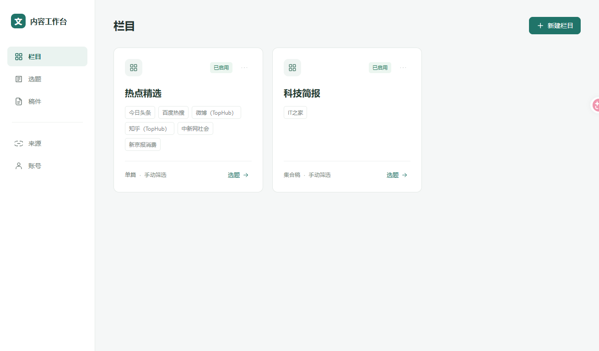
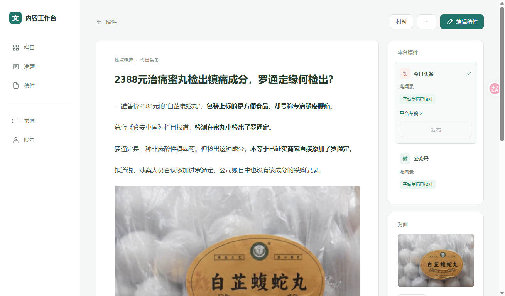
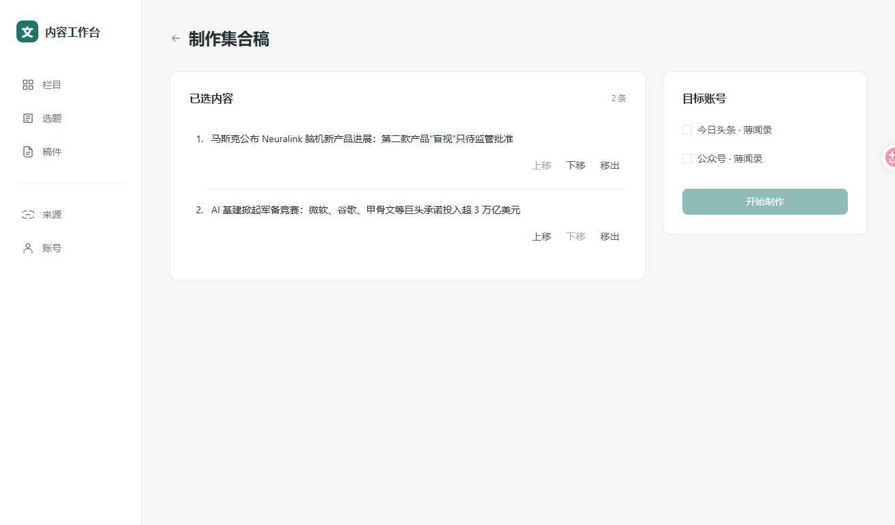
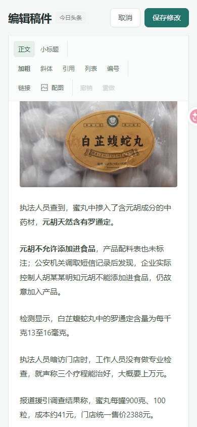

# 架构与界面验收记录

日期：2026-11-01。范围：栏目创建与独立渠道/筛选规则、工作台界面整改、可操作原型和架构文档。设计依据见 [架构与界面设计](架构与界面设计.md)，业务名词见 [CONTEXT.md](../CONTEXT.md)。

## 交付入口

- [实际工作台](http://127.0.0.1:18765/#/columns)
- [交互原型](http://127.0.0.1:18765/prototype.html#/columns)
- [原型空状态](http://127.0.0.1:18765/prototype.html?scene=empty#/columns)
- [原型加载失败](http://127.0.0.1:18765/prototype.html?scene=error#/columns)

本地入口使用现有 18765 服务；需要重新启动时运行项目根目录 `start-workbench.ps1`。原型与真实工作台共用 Vue 页面和样式，原型的创建/编辑只保存在页面内存，刷新恢复原始数据。原型中的采集、业务 AI、上传和平台操作明确不执行。

## 已落实的功能

| 模块 | 完成内容 |
| --- | --- |
| 栏目 | 页面创建、编辑、启停；独立渠道、筛选规则、创作要求、有效期、筛选方式、单篇/集合、自动筛选安排、目标账号与自动做稿配置 |
| 来源 | 已接入的七个来源；独立启停和自动采集间隔；栏目选择来源不会改变其他栏目 |
| 选题 | 按栏目读取共享池；采集限定当前栏目渠道；可做稿/待处理、选择保持、材料依据入口；移除所有栏目说明段落 |
| 制作 | 独立确认页面；集合条目上移/下移/移出、账号选择、缺少内容或账号时禁用开始 |
| 作品 | 服务端稳定 work_id，一作品一行；保留各平台稿、各账号、各版本及远端结果；按状态和栏目筛选 |
| 阅读与材料 | 正文与平台操作分区；平台切换、材料对照；发表条件在平台操作旁；正文保留加粗、斜体、列表、链接等格式 |
| 编辑 | 完整编辑页面统一修改标题和正文；工具栏分组、选中/禁用态、中文配图按钮、链接弹窗、取消和未保存离开保护 |
| 账号 | 平台身份与连接状态；添加、登录/核验入口；本轮未启动新账号连接 |
| 原型 | 同组件正常、空、失败场景；栏目配置、选题到制作、作品阅读/材料、编辑保存均可操作 |

## 验收证据

### 后端及数据边界

[35 项临时检查结果](../runs/architecture-ui-boundary-checks-20261101.json)：在临时目录和现有内容副本中验证，不调用业务 AI、不增加永久测试文件。

覆盖创建与配置重读、规则修改隔离、不同来源候选隔离、必填与数值/账号/重复名称/旧版本拒绝、停用采集/筛选、历史栏目禁止删除、未使用栏目可删除、独立来源与栏目调度、停用栏目跳过调度、创作要求从当前配置传给新稿。模型入口以临时拦截确认真实栏目规则进入输入，未额外发起付费模型请求。

使用四份现有稿件的隔离副本验证作品迁移不改写原 job 文件；稿件修改校验旧版本和空标题，保存后旧远端核对哈希失效、进入待审状态，其他三个平台稿不变。

### 实际服务与浏览器

实际页面创建“验收消费栏目”和“验收科技栏目”：分别只选百度热搜和 IT之家，填写不同规则。保存、API 回读、真实服务重启后配置保持；页面分别只出现对应来源的候选。修改消费栏目规则后，科技栏目规则保持不变。

真实 API 旧配置版本返回 409；删除已有内容的热点栏目返回 409。浏览器停用验收消费栏目后，采集和筛选按钮禁用；两个未使用临时栏目均已从界面删除。

真实科技简报页选择两条消息，刷新仍保留；进入制作页改序、移出一条、返回选题后剩余选择保持。验收所选内容已清空，没有启动新的制作任务。

真实稿件页完成材料对照、公众号/头条切换、图片加载、编辑标题后离开拦截、继续编辑、取消并放弃修改。原型中完成标题修改、正文整段加粗、保存后阅读回显；切换另一个平台稿时内容保持独立。公众号编辑区有相应字号/行距/段距控制。

[实际页面抓取](../runs/ui-acceptance-capture-20261101.json)：143 个请求，64 个保留操作。操作记录发生 9 次容量淘汰，因此不是完整逐操作录像；页面另有截图、API 和终端断言互证。唯一请求错误是主动重启服务期间的一次轮询连接拒绝，重启后恢复。测试中也遇到不可见原生复选框及共享页面观察变化拒绝，均保留首次失败，重新观察后使用可见控件继续，未绕过策略或另建会话。

[原型抓取](../runs/prototype-acceptance-capture-20261101.json)：41 个操作、9 个静态资源请求、0 个 `/api/` 请求、0 个错误，记录未淘汰。原型创建/编辑/删除栏目、来源安排、账号表单、选题到制作和编辑保存均经操作。

[最终页面检查](../runs/ui-final-browser-checks-20261101.json)：栏目/选题/稿件/账号空状态、加载失败与重试入口通过。390px 宽度下文档宽度为 390px；长文滚动后保存区底部与格式工具栏顶部均为 70px，没有正文插在两操作区之间。

### 原稿保护与运行状态

[最终数据比对](../runs/ui-final-data-check-20261101.json)：两篇作品、四份平台稿。四份稿件内容哈希与整改前完全一致，revision 均为 2、状态均为 remote_verified；远端 ID 分别为 7703080695194763818、7703083583019303466、100000026、100000030。两个原栏目及七来源保留，自动采集、自动筛选和自动做稿保持关闭，最终 busy=false。

前端最终 `npm run build` 通过，Python 语法与 `git diff --check` 通过。构建有现有体积提示（主包约 1.5 MB 未压缩）；不影响本轮功能验证。未创建 worktree、未提交/推送、未修改已有稿件或公开发表。

[浏览器资源结果](../runs/ui-browser-cleanup-20261101.json)：复用唯一会话 qoyc，任务结束活动会话为 0，两个本任务标签关闭。新增保存分组按本轮头条草稿 ID 确认后删除，保存分组数量恢复为原有 10 个；用于原生 Chrome 分组检查的临时空白窗口已关闭，共享 daemon 保留。该项收尾耗时过长；遵照用户最新指令，后续不再因无法直接删除而逐组查找或反复尝试。

## 页面截图

### 栏目

### 作品与平台稿

### 集合制作

### 窄屏长文编辑

## 结论边界

本轮栏目机制、界面整改、原型及文档已交付。真实双平台草稿保存/回读是此前四份稿件的结果，本轮验证其保持完整。长期无人值守运行、平台公开发表不由本轮界面检查推定；公众号发表未接入，头条发表未实机验收。新增网站仍需真实采集适配器，来源目录允许继续扩展，不把当前七来源当作永久清单。
