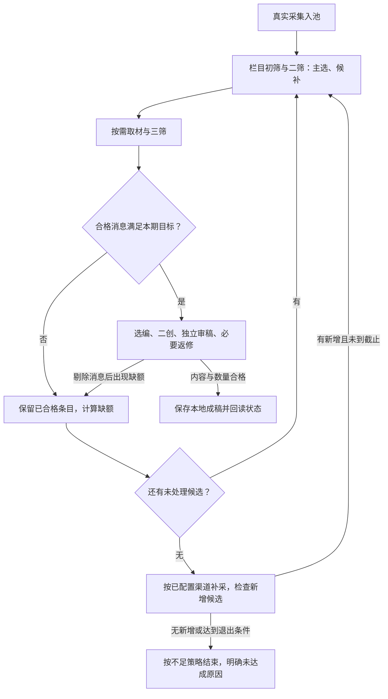

# 栏目编辑策略与全自动出稿验收

更新：2026-11-05。状态：实现、规则复核及最终清库实跑已通过；前两轮失败单独保留。最终证据见[01:15 清库全自动出稿验收](清库全自动出稿验收-20261105-0115.md)。

本文整理本轮用户要求及已经讨论清楚的问题，作为后续开发与验收的统一依据。与历史文档中的“集合只选少量、选零条也算正常结束”“集合套用单篇二创门槛”“静态检查通过即交付”等表述冲突时，以本文为准。现有代码、已测结果和待开发内容分别标明。

## 1. 交付目标与边界

系统以栏目为生产单位。每个栏目独立设置渠道、题材、时效、单篇或集合形式，以及筛选、选稿、写作、审稿、返修、配图和排版要求。公共程序负责采集、调度、材料复用、任务恢复及结果保存。

用户提出的场景是：早上 08:00 的“科技简报”使用集合形式，中午 12:00 的“科技在线”使用单篇形式；两栏可以使用不同渠道和编辑规则。时间均为北京时间。这是要支持的配置能力，不表示当前已创建第二个栏目、开启定时或具备公开发布能力。

科技、热点、娱乐是题材；单篇、集合是成稿形式。科技可以写单篇，热点可以做集合。代码不能按栏目名称决定筛选或写作行为。

**本轮最终验收终点：从清空后的业务数据开始，系统自动完成真实采集、选题、必要补筛、二创、独立审稿和必要返修，交付可查看的合格本地稿。单篇和集合稿都必须产出。** 平台同步、公开发布及长期定时稳定性不作为这次出稿验收的前置条件，也不能由本次结果推定完成。

### “没有 AI 辅助”的明确含义

沿用用户已经明确的边界：允许系统按配置自动调用模型；Codex／对话中的 AI 只能在验收前设置系统，验收时清理获准业务数据、启动正常入口、只读查看结果。

- 允许：系统自动归组、判断、取材、选稿、补筛、写稿、审稿、返修和处理已配置的重试；观察者只读查看状态、日志、调用回执和成稿。
- 禁止：观察者代采集、指定选题、补事实或时间、代写或改稿、修改数据库结果、手工拼接集合、临时更改提示词或门槛、绕过审稿、在卡住后替系统调用内部函数或点击后续步骤。
- 运行中代码、栏目规则、模型设置、渠道范围、条数和时效条件保持冻结。任务状态、正常缓存和系统产生的内容可以随执行变化。
- 系统自动调用的模型属于被验收系统；对话 AI、人工或外部代理替系统完成工作不属于自动化成功。

## 2. 问题与当前状态

| 问题 | 当前实现与证据 | 保持的约束 |
| --- | --- | --- |
| 流程结束仍显示“已入队” | 正式清库实跑回读：单篇与集合共 11 行均显示已成稿 | 候选、整期和稿件状态对应实际进度；成稿后不能永久停在已入队 |
| 集合只选一条，或把多个品牌当多条 | 按独立事件计数并冻结材料；正式产出 10 条消息的一期集合 | 消息按独立事件计数；同事件多来源只算一条；不能静默降为单篇 |
| 集合仍受单篇标准限制 | 集合独立使用消息要点、写作、逐条审稿和局部返修；单篇也移除了抽象新增贡献门槛 | 分开编辑策略和输出要求，不能靠追加“集合说明”抵消冲突 |
| 形式和筛选分支不一致 | 筛选与制作均由 format 决定，四种旧 mode／format 组合临时检查通过 | 形式决定单篇／集合基础策略；栏目规则决定具体题材和取舍，旧模式不能隐式覆盖形式 |
| 时间核实过重 | 已移除正文日期空即否决及逐条证明日期要求，保留实际时效和冲突判断 | 已有正常时间直接使用；仅在缺失或冲突影响选用时处理，不逐条追加时间证明 |
| 候选准备不足且没有自动补筛 | 自动候补、补筛、补采及写审后原任务补齐已实现；最终本轮取足 10 条，无需触发补筛 | 根据出稿目标准备余量；核实、选稿、审稿损失条目后自动补齐 |
| 成稿默认要求注明来源 | 正文默认不附来源清单，内部关键事实仍关联实际材料；本轮两篇已回读 | 内部材料关联与成稿展示分开，按栏目规则决定是否展示来源 |
| 初筛慢、重复输出多 | 初筛两路并行、各路复用会话、引文编号引用已实现并加载 | 保留优化；后续不得重新积累重复输出或改回整栏串行 |
| 总 token 无法说明实际效率 | 最终本轮 851,227 token、12 分 36 秒交付 1 篇单篇 + 1 篇 10 条集合；失败轮消耗另记 | 按实际合格产出、各阶段耗时和完整用量报告，不以少出稿证明节省 |

上轮清库实跑未通过，见[清库后全自动实跑记录](清库后全自动实跑-20261104-2017.md)。初筛局部对照的 64 个事件由 284.102 秒降至 113.677 秒，未缓存输入减少 15.0%、输出减少 39.8%；该结果仅证明这一批初筛的改进，见[初筛验收记录](初筛并发与输出压缩验收-20261104.md)。这些历史证据不能替代本文件要求的最终新一轮实跑。

## 3. 栏目配置如何控制实际执行

### 3.1 配置归属

| 配置 | 负责什么 |
| --- | --- |
| `sources`、`rules`、时效范围 | 从哪里取材、面向谁、包含和排除哪些内容 |
| `format` | 选择单篇或集合的基础编辑策略和数据结构，不绑定题材 |
| `screening_rules` | 初筛、二筛、三筛各自的栏目判断规则 |
| `draft_rules` | 单篇选稿，或集合的入选、候补、取舍和排序要求 |
| `writing_rules`、`production_rules` | 写作、补证、审稿、返修、配图和排版的实际指令 |
| `format_policy` | 消息条数、每条篇幅与段落、结构、配图和不足交付条件 |
| `max_candidates` | 每轮二筛准备的取材候选上限；不得被解释为整个期次只能尝试一次 |
| 出稿计划与目标 | 期次、准备与截稿时间、交付方式；与采集节奏分开 |

模型连接和角色设置继续共用。每次调用必须使用当前栏目、形式和阶段对应的规则快照，不能被隐藏的全局“热点单篇”要求覆盖。

### 3.2 默认模板与用户规则

单篇和集合分别提供完整的可编辑模板，覆盖筛选、选稿、写作及审稿，不只提供字数模板。新栏目使用模板起步，保存后的栏目规则才是执行依据。模板升级不能静默覆盖已有自定义要求。

整理现有栏目时，要把“本期少量消息”“必须有独立读者问题”等残留规则及冲突的公共提示词一起改正。形式字段改了而旧的单篇要求仍在生效，不算完成。切换形式后，运行快照、阶段缓存和审稿依据必须与新形式一致；旧稿和旧记录留作历史。

代码允许按通用形式选择执行策略、验证条目关联；不得写入“栏目名为科技简报就选 10 条”之类业务判断。条数、篇幅、来源展示与配图数量均来自栏目配置。

## 4. 单篇与集合的编辑策略

### 4.1 筛选与选稿

| 环节 | 单篇 | 集合／简报 |
| --- | --- | --- |
| 初筛 | 是否有值得独立讲清的事件、读者关切或具体信息价值 | 是否属于栏目范围、有值得告知的新消息；无需具备独立长文价值 |
| 二筛 | 比较文章价值、可写角度及材料可获得性，选择适合独立成文的题 | 比较新增信息、重要性、实际影响、整期覆盖与重复，准备主选和候补 |
| 三筛 | 正文是否支持文章主线与必要背景 | 正文能否写清一条准确短讯；不要求争议、深度分析、独创观点或长篇素材 |
| 选稿输出 | 选择、具体写作角度、理由及必要材料关联 | 入选／候补／不选、消息要点、理由、排序及材料关联 |

集合取消强制 `reader_question` 和“每条都要证明解释／比较角度”的准入门槛。不能因消息适合简明选编而将其降成必须署名“搬运”的另一种生产任务。单篇也不被强制写成长文或制造冲突，具体要求由栏目决定。

初筛只使用已有标题、摘要、来源和时间，不为全部候选读取正文。对题材相关且可能有信息价值的消息宽进，只有已有输入能证明的明确负面理由才淘汰；没写清不等于没有。新观点、新公开材料和讨论都可以有价值，不以产品发布或技术突破为普遍门槛。二筛保留足够余量，再按优先顺序和执行并发取材；候补未轮到不必全部读取全文。只有核心消息辨认不了、题材不符、明显旧闻、广告或缺少实质信息等实际问题才构成相应淘汰／待办理由，不能因为尚未阅读正文就提前否定可正常取材的消息。

“重要性”和“多样性”是栏目编辑判断，不转换为统一打分表、固定类别配额或每个品牌必须入选。不同来源报道同一事件合并；新进展是否独立成条按内容判断，不按标题或品牌数凑条数。

### 4.2 写作

单篇围绕选定事件或问题组织一篇完整正文，交代关键变化、必要经过和事实限定。材料应足以支持实际展开的内容，不为字数补空话或不存在的观点。准确简明地讲清事件本身就是有效成稿，不强制比来源多出新事实、新观点或覆盖所有已读细节。审稿必须定位具体事实、理解、题目兑现或栏目要求上的问题，不能抽象地以“新增贡献不足”反复退回。

集合以整期为创作任务，一次组织多条消息；每条绑定自己的事件 ID 和实际采用材料，输出独立短标题、简讯正文及可选图片关联。统一编排，不将每条简讯先当独立长文制作。

每条简讯优先交代：谁发生了什么、最新变化、关键事实或数字、目前处于计划／测试／已实现的哪种状态；影响或背景仅在帮助理解且材料足够时加入。不强制每条都补分析、观点、提问或结尾。

本轮集合配置：目标 10 条、允许范围 8–12 条、独立小标题。默认不设置每条最少字数、最多字数或段数；一般一段能说清就一段，篇幅随信息量。短消息不是材料不足，不为凑字扩写、退稿或换题。条数是栏目可编辑配置，不是行业统一标准或代码常量；另有明确篇幅要求时可以在栏目填写。

总标题体现栏目、本期或主要消息；栏目名和日期可由配置模板生成，不需要为这些展示字段额外寻找事实引文。标题包含具体新闻断言时，再关联对应条目核对。全文不自动添加通用导语、总结、内部审稿过程和自评。

Apple 与千问如果属于两件独立新闻，应分别成条；如果属于同一合作事件，则合并为一条。品牌数量不是消息数量，也不能把不同事件的事实串成同一个进展。

### 4.3 审稿和返修

两种形式均保留独立审稿，但使用对应的栏目标准。

- 单篇检查标题是否兑现、主线是否讲清、关键事实与范围是否准确、表达是否自然。
- 集合逐条检查消息与材料是否对应、关键事实是否正确、不同事件是否混写；整期检查重复、排序、标题、条数、篇幅和栏目范围。
- 集合的编辑价值是选择、去重、压缩与编排，不因缺少长文论证或额外观点而退稿。
- 返修定位具体条目或段落，只改有问题的部分；一条缺材料不能导致其余合格条目全部重写。
- 关键事实和问题应能对应实际材料，但不要求作者与审稿员在输出中各复述一遍完整稿文。使用条目／段落编号和版本关联，内部记录不进入成稿。
- 单篇标题和独立审稿用现有原句编号绑定材料。排版只建议断句位置与强调短语，程序从审定稿取字；无效标记忽略，排版建议失败时保留原稿。
- 每篇稿独立完成制作。合格稿继续同步，失败稿保留原因。全部目标平台回读通过才算整轮成功，平台结果不明时不重复提交。
- 简报选稿沿用三筛核实过的引文。写稿不抄引文；独立审稿逐句选择本条来源的原句编号，程序回填来源和原文。找不到足以支撑某个断言的原句，就退修该条。整期标题可以引用多条消息。
- 增删条目或改变事实后，对变化部分及受影响的整期标题、顺序、数量重新核对。独立审稿仍直接读取材料与待审内容，不采信作者自评或旧“通过”字样。

简报默认不配正文图。只有图片对理解某条主题确有必要时，该主题最多一张；这不是整期最多一张。先判断必要性，再准备少量对应原图；无需要则不下载候选图，不为装饰扩展搜图。平台封面使用现有项目封面，封面不插进正文。图片策略及每条上限跟栏目保存，不能按“科技”等名称写死。没有正文图不淘汰消息，不生成图片兜底。排版保留已审定文字。

## 5. 时间和来源要求减负

### 正文、章节和强调

- 二创正文用短句，不用中文或英文分号。事实转到原因、影响或办理条件时可以另起一段，一条简讯也可以有多段。
- 每个子问题都需要几段展开时才分章。平行子问题用短标题，存在先后推进的章节或必须依序执行的步骤才编号。
- 简报每条新闻一个短标题。只有整期确有不同栏目组时才加组名。公众号用封面主色的横条显示组名，头条用原生标题显示组名，组内新闻标题单独一行加粗。
- 加粗标核心消息。下划线单独标容易漏读的条件、例外或期限。两个标记都可省略，同一处不叠加。公众号用封面色点线。头条草稿实测会去掉正文的下划线，提交头条版时保留条件原文，用正常字重；标题和核心事实的加粗仍需回读一致。

### 5.1 时间用于时效判断

采集条目或报道已有正常发布时间、与栏目时间范围一致且没有明显冲突时，直接使用。正文没有重复标日期，不构成单独否决理由；不要求每条消息另行完成“证明时间来自官方订阅”的流程。

采集时间、报道时间、事件时间在内部字段中不混用，但这不意味着必须为每条查齐三个时间。只有时间缺失或冲突会改变是否入选、是否把旧闻当新进展时，才需要针对性处理。程序能从已有元数据取到的信息直接传递，不为复制这些信息追加模型调用。

明显过期的事件没有新进展，仍不用于当期简报；确实无法判断且影响本期时效的，列为待补或改选其他候选，不围绕一条消息无限调查。上轮那 5 条不能仅因统一放宽日期要求就全部强制通过。

### 5.2 内部出处与成稿展示分离

内部保留采集链接、实际材料、条目关联及必要时间，供系统复用和检查。默认不在成稿末尾附来源清单，不为每条强制加入“据某某媒体报道”。是否展示、展示位置与格式由栏目写作要求决定。

涉及某人的说法、某机构自述或直接引语时，保留理解这条消息所需的自然归属，不能把“某方声称”写成独立确认的事实。内部取材记录不作为给正文增加大量出处文字的理由。

## 6. 根据出稿目标备选与自动补筛

### 6.1 取材量与成稿量分开

集合目标 10 条，不应只准备刚够 10 条取材候选。开发起点可将首轮候选配置为约 20 条，在现有 `max_candidates` 中明确保存；最终值在验收前冻结。20 是示例配置，不是永久比例或新增的隐式代码限制。

二筛输入必须包含本期目标、已合格数量、缺额、本轮取材上限和剩余候选，要求在适合栏目且候选充足时准备足量主选与候补。不能只提示“选少量、最多 N 个、可以全不选”，而完全忽略整期出稿目标。质量判断仍由栏目规则执行，不随机填满。

### 6.2 自动循环

补筛不仅处理三筛淘汰：选稿、写稿或审稿删除条目后，只要不再满足本期条件，同样回到补齐流程。已合格条目、已读材料和已完成的简讯继续复用，不重筛整池、不重读整批正文、不重复生成合格内容。

补筛处理本期尚未尝试的候选或确有新材料的待补项。每轮记录取用、淘汰、缺额和剩余候选；不能反复处理依据未变化的同一组失败条目。补采只使用栏目已配置渠道和范围，未产生新候选时不空转，也不自动扩大到其他栏目或旧时间范围。

同一期保持一个作品身份。补条、返修和恢复更新原任务，不能因每次不足新建一份稿件。系统退出、失败和重启的恢复仍使用已有任务机制，不另建通用工作流平台。

### 6.3 何时结束

- 正常完成：达到本期目标，且成稿与审稿满足冻结的栏目配置。
- 少于目标但仍在允许范围：只有预先配置的不足交付条件成立，并且自动补筛记录解释了为何没有补到目标时，才允许按该条件交付；不能看到结果后临时改最低条数。
- 未达到最低条数、关键正文不可得、候选耗尽且补采无新增、超过本轮既定执行预算或截稿时间：明确显示不足／失败，不伪装成已完成或已入队。
- 停止请求按用户或任务设置生效；临时服务错误按已有自动重试配置处理。业务条数不足是补筛问题，不靠重复调用相同失败任务解决。

即时验收不等待下一天的新闻凑数。若本轮确实无法出稿，该轮验收不通过；系统必须留下原因，但“正确报不足”本身不能替代本轮要求的实际出稿。

## 7. 界面与状态

需要能看到采集、初筛、二筛、取材／三筛、补筛、二创、审稿／返修、已成稿或不足／失败的真实进度。界面不必增加复杂配置页，复用现有栏目和过程侧栏。

集合展示“已合格条数／目标条数”“本轮正在补多少条”“N 条消息组成 1 篇稿”。成员条目关联同一集合制作任务；已成稿成员不能仍显示“已入队”。筛选批次结束与整期出稿完成必须区分。

素材待补、候选耗尽、系统失败分别给出具体原因；不能用一句“等待下次选稿”掩盖尚未实现的自动补筛。日志和 token 明细留在已有过程详情，不堆入文章或主操作流程。

## 8. 速度与 token

保留已验证的初筛两路执行、每路复用会话、跨栏目合计并发上限及简短输出。正文只对需要取材的候选获取，材料在有效版本内复用；集合按整期编写，局部返修，不把每条变成完整单篇流程。

公共程序完成条数、顺序、编号、模板排版等确定性动作。模型只输出当前阶段需要的判断与内容，避免重复全文、重复引文、重复前轮理由；不能为了节省而删掉用户要求的审稿或减少应交付消息。

每轮报告实际总耗时及各阶段耗时，区分并发等待、调用耗时与取材耗时；无法分辨服务端排队或首响应时明确留空，不猜测根因。用量列输入、缓存输入、未缓存输入、输出、调用数、失败重试和未知用量次数。

效率按合格单篇数量、合格集合期数及集合消息数分别报告，不能将“只出一篇所以总 token 下降”当优化成功。开发对照实验与正式验收分别计量，失败试验也计入总消耗。已有初筛历史对照不重复冒充完整流程性能结论；未实测前不承诺固定分钟数或费用降幅。

## 9. 开发落点与顺序

以下为待实施清单，不表示当前已完成：

| 顺序 | 代码／配置范围 | 改造内容 | 对应完成条件 |
| --- | --- | --- | --- |
| 1 | `column_templates.json`、`columns.py`、栏目编辑页 | 两种形式的完整阶段模板；修正现有栏目中冲突要求，明确取材量与成稿量 | 科技／热点等题材均可选择单篇或集合，实际调用采用所存规则 |
| 2 | `screening_policy.py`、`screen.py`、`review.py`、`line_review.py` | 按形式生成筛选输入与输出；移除单篇维度对集合的硬要求；缩小时间检查范围 | 集合能保留适合短讯但不适合独立成文的消息，初筛优化保留 |
| 3 | `draft_selection.py`、选稿规则 | 单篇与集合选稿要求分离；集合不必填读者问题和独立文章角度 | 选稿返回独立消息与候补顺序，不按共同问题或品牌数拼稿 |
| 4 | `workspace.py`、已有期次与制作调度 | 采集到出稿自动衔接；缺额补筛、候选复用、退出条件和恢复 | 任一阶段损失消息后自动补齐，观察者不用接力启动后续阶段 |
| 5 | `composition.py`、`editorial.py`、审稿规则 | 两种写作和审稿契约；集合按条目组织，局部返修，减少重复输出 | 成稿像简报，单篇保持独立文章逻辑；系统独立审稿通过 |
| 6 | 图片／排版与候选、选稿状态界面 | 栏目化来源展示、图片和结构；任务状态贯通 | 成稿不含内部审计文字，成员状态与实际稿件一致 |
| 7 | 现有清理与运行入口、验收记录 | 清库后完整实采运行与只读观测 | 达到第 10 节的最终通过条件 |

开发可做必要的临时验证，包括四种题材／形式组合、候选不足后补齐、审稿剔除后补齐、无新增时终止、取消与恢复、配置冻结及状态关联。不新增仓库测试框架或样本，不用模拟调用替代最终实跑。前端改动完成相关构建，代码改动做最相关检查；不为文档整理启动业务。

## 10. 最终验收：先清空，再全自动跑到合格出稿

### 10.1 启动前完成设置并冻结

先完成开发和必要检查，确定本轮单篇与集合两个栏目、真实渠道、时效、条数、写作与审稿要求、自动补筛与退出条件、模型、图片及交付方式。最终产出至少包含本轮真实采集产生的 1 篇合格单篇和 1 篇合格集合；若配置要求更多，按冻结配置验收。

默认集合起点是目标 10 条、范围 8–12 条；是否按低于目标但满足最低条数交付，必须在运行前明确，不能运行中解释或改写规则。单篇不得用集合中的某一条短讯冒充独立文章交付。

记录代码版本及未提交差异指纹、实际生效配置和模型快照、渠道范围、验收起点与目标。冻结快照要能区分模板与当前保存值。与本轮无关的定时任务不能在清理或验收期间插入业务执行。

### 10.2 清空的范围

清理前核实当前项目目录、持有进程和活动任务，暂停本项目调度并处理自己持有的浏览器资源。清空的是**本项目内容业务数据**，不是代码仓库、整台电脑或账号登录。

| 清空 | 保留 |
| --- | --- |
| 线索池和采集批次、原始采集业务快照 | 源码、依赖、渠道与栏目设置 |
| 归组、初筛、二筛、三筛、选稿记录及其可复用业务缓存 | 模型连接、凭据、角色配置及运行配置 |
| 旧作品、制作队列、二创／审稿／返修内容、图片与排版业务缓存 | 已核实的平台账号、现有单账号维护配置 |
| 旧期次、补筛、重试、占用、采用及执行进度 | Chrome 登录、扩展、浏览器实例与端口映射 |
| 本项目旧模型任务会话引用，防止新一轮续接旧业务判断 | `platform-accounts/browser-control.json` 与账号必要配置 |

实际清理以绝对路径和数据归属确认后的本项目业务目录为准。不能全局删除 Codex 登录或其他项目会话；不能删除租约记录来假装浏览器资源已释放。历史验收的必要失败记录与用量可以留在独立报告中，但不得回灌为新一轮输入或判断结果。

清理后检查业务计数为零、无旧任务待自动恢复，保留配置可读且与预期一致。模型服务端通用前缀缓存可以正常使用并计量，但不能复用旧稿、旧筛选结论或历史采集响应。

### 10.3 只能通过系统正常入口启动

从真实渠道重新采集，系统自动完成栏目取候选、三筛、选稿、缺额补筛、二创、审稿、必要返修和本地成稿。可以通过产品页面或正式业务 API 启动；启动后各阶段由系统自己衔接，不由观察者逐阶段接力。

不为验收另写一套外部脚本代替生产调度。只读观察脚本可以汇总进度和用量，但不能写入选题、稿件、状态或发起卡点补救。若现有入口需要人工在下游停住时补点按钮，先在开发阶段补齐系统衔接，再开始正式验收。

真实取材使用本轮系统持有的浏览器会话与现有账号配置；不能按消息或重试不断新建会话。无浏览器需求的读取正常走已有 HTTP 适配器。验收终点是本地稿，不发起平台草稿写入或公开发布。

### 10.4 通过条件

| 检查项 | 必须观察到的结果 |
| --- | --- |
| 冷启动 | 本轮业务数据从零开始，输入来自本轮真实采集，不是历史回放或预置样本 |
| 自动化 | 运行中人工／对话 AI 代做采集、选题、写稿、改稿和手动救场均为 0；代码和配置未变 |
| 单篇 | 至少 1 篇完整本地单篇，系统按该栏目规则完成二创及独立审稿 |
| 集合 | 至少 1 篇完整本地集合稿，独立消息数、内容结构、每条篇幅与图片符合冻结配置，系统独立审稿通过 |
| 补齐 | 有缺额时系统自己补候选；不存在候选未耗尽却停在不足条数的断点；整期复用已合格条目 |
| 稿件质量 | 不把一条消息当集合，不按品牌凑数，不混写不同事件，不强加单篇分析；成稿不含内部审计与默认来源清单 |
| 状态 | 页面与持久化记录能读回实际成稿，候选成员不再停在已入队；筛选完成与作品完成不混淆 |
| 效率 | 报告完整耗时、实际 token、缓存、重试及合格产出；少交付或漏记用量不能作为节省证明 |
| 收尾 | 没有本轮遗留的活动任务；按项目规则释放并核对自己创建的浏览器资源，保留原账号与用户资源 |

静态检查通过、模型返回通过、任务进入队列、只得到首次草稿或只产出单篇，都不能替代上述最终出稿验收。

若本轮没有自然触发补筛，可用开发阶段的必要临时检查证明该分支，再在正式报告中注明未实际触发；不能在正式运行中故意删条制造补筛，也不能谎称本轮验证过没有发生的分支。对于本次已知的“不足后不会补筛”，必须有自动补筛到恢复的实际或临时验证证据，且不能仅验证报错文案。

### 10.5 失败与重新验收

系统按冻结规则自行重试、补筛或局部返修，仍属于同一轮自动运行。若必须由人改代码、改规则、补事实、换选题、修改稿件或修正任务状态，该轮立即记为未通过，保留首次现场与已消耗用量。

修复放在该轮结束之后。修复完成后重新冻结版本、再次清空业务数据、从真实采集启动一轮完整验收。不得把前一轮成功步骤与人工修复后的局部成功拼接成“全程无人干预”。

最终报告必须列明实际稿件和消息条数、系统审稿结论、补筛／返修过程、页面与记录状态、人工介入次数、代码／配置指纹、耗时、token、失败与恢复记录。只有完整达到目标的一轮才记“通过”；文档完成、局部提速或能够正确报不足均不等于最终交付完成。

## 11. 本文交付状态

实现和验收已完成。首次实跑暴露初筛、篇幅、贡献门槛及图片预下载问题，第二次暴露图片返回值接反；两轮均未通过，修正后第三次重新清库完整通过。规则复核及修正见[规则复核与修正](规则复核与修正-20261105.md)。

前一轮设计与实现记录见[栏目驱动生产设计与实施](栏目驱动生产设计与实施-20261104.md)。历史媒体样本与配置起点沿用该文档的研究记录；本文不把历史样本计数当作统一行业标准，也不新增未经核查的外部结论。

## 12. 本轮实施与复核记录

已实现：形式独立模板；集合按消息写作、逐条独立审稿与局部返修；三筛、选稿及审稿缺额自动补筛；同任务保留已合格条目；正常时间直接使用；默认正文不附来源清单；单稿审计通过段号引用而非重复全文。

统一入口为选题记录页“采集并出稿”（`POST /api/production-run`）。它使用已有采集配置、栏目快照和模型配置推进全部阶段，候选耗尽后按原渠道补采，无增量则明确失败。`GET /api/production-run` 提供本轮状态及关联批次、稿件。

临时检查覆盖四种旧 mode／format 组合、三筛不足继续补筛、已通过消息不重读、集合局部返修、审稿缺料原任务替换、统一入口完整推进与无增量终止。前端生产构建通过。以上均为开发检查，不代替真实验收。

11 月 5 日追加检查：短简讯通过、初筛淘汰须有输入证据、无必要图片时零下载／零搜图、单主题图片上限、候选图准备数量有界、模型校验失败仍记录实际用量。具体检查及两轮失败记录见规则复核文档；最终重新清库结果见[正式验收报告](清库全自动出稿验收-20261105-0115.md)。
